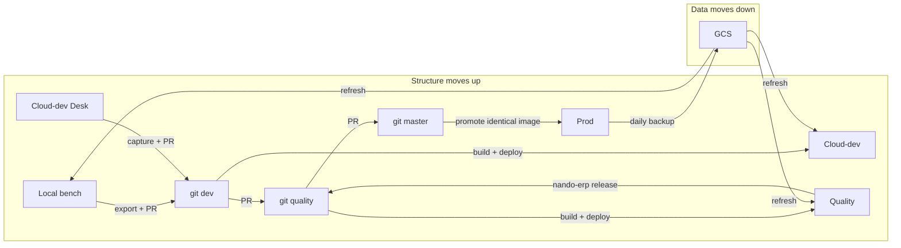

# NANDO ERP pipeline — overview

High-level guide for how we develop and ship ERPNext customizations.
For infrastructure (compose, Traefik, TLS), see [DEPLOYMENT.md](../DEPLOYMENT.md).
For step-by-step recipes, see the [guides/](guides/) folder.

## Mental model

| What | Moves | Source of truth |
|------|-------|-----------------|
| **Structure** (DocTypes, custom fields, property setters, client/server scripts, workspaces, sidebars, reports, dashboards, roles, workflows) | **Up only:** local → git → cloud-dev → Quality → prod | Git fixtures in [`nando-erp-modules`](https://github.com/Waste-NANDO/nando-erp-modules) |
| **Data** (customers, items, Business Units, Configuration Templates, transactions, …) | **Down only:** prod → Quality / cloud-dev → local | Prod DB (restored from GCS backups) |
| **Secrets / site settings** (Email Account, Google Settings, System Settings, API keys) | **Never synced** | Each environment |

Desk UI structure edits are allowed on **local**, **cloud-dev** (quick checks only), and **Quality** (hotfixes, captured by `nando-erp release`). Prod runs with `developer_mode=0` — never edit structure there.

## Environments

| Env | Where | URL / site | Image / branch |
|-----|-------|------------|----------------|
| **Local** | Native bench on your laptop | `nando.local` | Symlinks into `nando-erp-modules` |
| **Cloud-dev** | Docker stack `erpnext` | `:3003` | Built from `dev` |
| **Quality** | Docker stack `erpnext-quality` | `:3001` | Built from `quality` (hotfix / UAT) |
| **Prod (main)** | Docker stack `erpnext-main` | `:3000` | **Same image** promoted from Quality (retag, no rebuild) |

Version pins for Frappe / ERPNext / HRMS live in one file: [`versions.env`](versions.env).
What counts as structure lives in [`structure.yaml`](structure.yaml).

## Apps and ownership

Both apps live in one repo: [nando-erp-modules](https://github.com/Waste-NANDO/nando-erp-modules).

| App folder | Module | Notes |
|------------|--------|-------|
| `nando_crm/` | `NANDO_CRM` | CRM Desk config (+ `NANDO_HR` until split) |
| `nando_fulfillment/` | `NANDO_Operations` | Fulfillment / ops Desk config |

Branches: `dev` → `quality` → `master` (prod).

Every structure document must belong to exactly one module. Lint fails if a fixture has no module (or the wrong one), or if both apps would export the same document. Each app's `hooks.py` fixtures list must cover every type in `structure_doctypes`.

Desktop Icon and Role have no `module` field in Frappe — we own them by name prefix (`NANDO…` / `Nando…`).

## Tooling

One CLI/library: **`nando-erp`** ([`tools/nando_erp_ops`](../tools/nando_erp_ops)).

- Run on the **ERP host** with `NANDO_EXECUTOR=local` (talks to Docker directly).
- Run from **laptop / Lambda** with `NANDO_EXECUTOR=ssm` (AWS SSM Run Command on that host).

Command cheat-sheet: [tools/nando_erp_ops/README.md](../tools/nando_erp_ops/README.md).

## Day-to-day in one glance

1. Edit structure on **local** Desk (feature branch in `nando-erp-modules`).
2. `nando-erp export` → `nando-erp lint` → commit → PR into `dev`.
3. Merge to `dev` → build + deploy cloud-dev (`nando-erp build --stack dev && nando-erp deploy dev`).
4. When ready for UAT / prod: PR `dev` → `quality`, then build + deploy Quality.
5. Hotfix on Quality Desk → `nando-erp release --yes` → approve PR to `master` → promote.
6. Refresh data when needed: `nando-erp refresh --target quality` (or `dev`).

## Step-by-step guides

| Guide | When to use it |
|-------|----------------|
| [01 — Local setup](guides/01-local-setup.md) | First time on a laptop, or after version pin changes |
| [02 — Develop a structure change](guides/02-develop-structure.md) | Normal feature work (DocTypes, scripts, UI, …) |
| [03 — Deploy to cloud-dev](guides/03-deploy-cloud-dev.md) | Ship `dev` to `:3003` |
| [04 — Capture cloud-dev drift](guides/04-capture-drift.md) | Desk was edited on cloud-dev; deploy is blocked |
| [05 — Promote to prod](guides/05-promote-prod.md) | Ship the validated Quality image to `:3000` |
| [06 — Refresh data from prod](guides/06-refresh-data.md) | Pull prod data down to Quality, cloud-dev, or local |
| [07 — Backups](guides/07-backups.md) | Scheduled + pre-deploy / pre-refresh backups |
| [08 — Phase 0 baseline](PHASE0_BASELINE.md) | **One-time** cutover: git fixtures = prod |
| [09 — CLI, SSM, and API](guides/09-cli-ssm-api.md) | Install `nando-erp`, SSM from laptop/Lambda, FastAPI mount |
| [10 — Release a hotfix](guides/10-release-hotfix.md) | Quality Desk → `release` → master → prod |
| [11 — Cutover to nando-erp-modules](guides/11-cutover-monorepo.md) | One-time switch from old app repos |

## Related docs

| Path | Contents |
|------|----------|
| [guides/](guides/) | Step-by-step recipes |
| [PHASE0_BASELINE.md](PHASE0_BASELINE.md) | One-time prod → git cutover |
| [reference/](reference/) | Assets, custom fields, workspaces, compose snippets |
| [deprecated/](deprecated/) | Old live-DB sync — do not use |
| [../DEPLOYMENT.md](../DEPLOYMENT.md) | Stacks, Traefik, volumes, upgrades |
| [../tools/nando_erp_ops/README.md](../tools/nando_erp_ops/README.md) | CLI command list |
